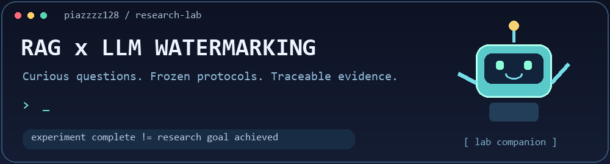

# Hi there, I'm piazzzz128 👋

<picture>
  <source media="(prefers-reduced-motion: reduce)" srcset="assets/rag-lab.png" />
  
</picture>

用可复核的实验，研究 **RAG 知识水印的边界泄漏、定位与删除**。🔬

### 🛠️ Technologies & Tools

  

`GainRatio` · `Qwen2.5-7B` · `Contriever` · `NumPy / Matplotlib` · `Frozen protocols`

### 🧠 About This Lab

- 🔍 **Boundary leakage**：研究原始正文与追加水印接缝中的统计信号。
- 🧪 **GT-blind evaluation**：用原始文本和 GainRatio 做候选判断，GT 仅用于冻结后的评估。
- ⚖️ **Utility & damage**：同时保留正常正文损伤、检索代理、真实对照与 Unknown。
- 📦 **Reproducible evidence**：用协议、逐单位结果、审计和 SHA256 连接结论与来源。

### 🚀 Featured Research

#### [piazzzz128/ragwm-boundary-leakage](https://github.com/piazzzz128/ragwm-boundary-leakage)

RAG-WM 边界泄漏研究：从似然评分、受控接缝干预，到未知接缝定位与正文损伤评估。

| Research track | What I'm working on |
|---|---|
| 🧩 [Seam mechanism](https://github.com/piazzzz128/ragwm-boundary-leakage/tree/main/results/extensions/research_progress_20261030/README.md#2-controlled-sentence-seam-mechanism-evidence-not-an-unknown-seam-attack) | 只改变一个句号，检验接缝对定位和水印验证的影响 |
| 🛰️ [Unknown-seam localization](https://github.com/piazzzz128/ragwm-boundary-leakage/tree/main/results/extensions/research_progress_20261030/README_zh-CN.md#1-正文上下文资格定位与删除改善损伤门失败) | 虚拟句界与正文资格；同时检查有效性和误删成本 |
| 🧾 [Evidence & CPU code](https://github.com/piazzzz128/ragwm-boundary-leakage/tree/main/src/experiments/body_context_boundary_20261029) | 冻结方法契约、完整分母、可复算结果与负面证据 |

### 📓 Latest Lab Notes

**2026-10-30 · Research in progress**

新的独立 NQ40 验证中，WSN 为未处理 **34/40**、RAW **33/40**、BIN **31/40**、
虚拟方法 **14/40**，全部 Unknown=0；首动作定位为 **127/151**。

> 🎯 最终目标仍是 **WSN≤4，争取≤3**，并满足损伤与效用约束。
> 当前正常字符损伤 **0.815% > 冻结 0.5%**，低损伤联合资格仍未通过，目标尚未达成。

[📖 中文科研进展](https://github.com/piazzzz128/ragwm-boundary-leakage/tree/main/results/extensions/research_progress_20261030/README_zh-CN.md) · [🌐 English results](https://github.com/piazzzz128/ragwm-boundary-leakage/tree/main/results/extensions/research_progress_20261030/README.md) · [📊 Frozen evidence](https://github.com/piazzzz128/ragwm-boundary-leakage/tree/main/results/extensions/research_progress_20261030/body_context_boundary/RESULTS.json)

历史 NFCorpus 正式 **26→21/30**、受控句号实验及新 NQ40 各自保留，不跨实验拼接。

### 🐍 Contribution Playground

<picture>
  <source media="(prefers-color-scheme: dark)" srcset="https://raw.githubusercontent.com/piazzzz128/piazzzz128/output/github-snake-dark.svg" />
  
</picture>

### 🤝 Let's Connect

欢迎通过 [GitHub Issues](https://github.com/piazzzz128/ragwm-boundary-leakage/issues) 交流 RAG、水印鲁棒性、实验复现与误差分析。

Made with <a href="https://github.com/mizane446/github-profile-optimizer">github-profile-optimizer</a>

